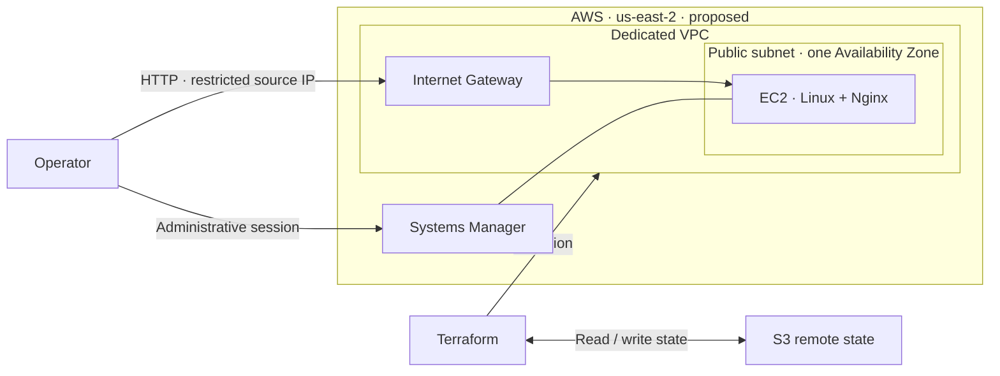

# AWS Terraform Lab

A hands-on DevOps lab for designing, provisioning, validating, and tearing down AWS infrastructure with Terraform. The goal is to build a reproducible environment and document the reasoning behind its networking, access controls, state management, and cost decisions.

> **Status: Planning.** This repository currently contains documentation only. No infrastructure has been deployed by this project.

## What this project will demonstrate

- Infrastructure changes defined in Terraform and reviewed through Git.
- AWS networking and service permissions with explicit boundaries.
- Protected remote state and controlled infrastructure changes.
- Verification that covers service behavior, security, and reproducibility.
- A documented teardown process and evidence of the results.

The project follows **Spec → Plan → Build → Test → Review**. Each phase should produce something that can be inspected and explained.

## Project constraints

| Area | Decision |
| --- | --- |
| AWS Region | `us-east-2` (Ohio) |
| Environment | One temporary `dev` environment |
| Spending | Zero out-of-pocket AWS spending |
| Deployment | Paused until scope and cost coverage are verified |
| Repository | Private during initial development |
| Documentation | English |

The spending requirement is a design constraint, not a claim that the proposed services are free. Before any deployment, verify the active AWS plan, available allowances or credits, expected usage, and cleanup requirements. Include compute, storage, public IPv4 addresses, and data transfer in that review.

Do not upgrade the AWS project to a paid plan or activate paid features as part of this lab. Adjust the architecture if it cannot meet the spending requirement.

## Proposed architecture

The initial design is a small, single-Availability-Zone lab. It remains a proposal until the cost review is complete.

- A dedicated VPC with one public subnet, an Internet Gateway, and a route table.
- One Linux EC2 instance running Nginx and a simple demonstration page.
- A Security Group that restricts HTTP access to the operator's IP.
- Administrative access through AWS Systems Manager Session Manager.
- An IAM role for the instance, with permissions limited to its required tasks.
- Terraform state in a separate S3 backend with encryption, versioning, blocked public access, and state locking.

High availability, load balancing, databases, Kubernetes, and a production application are outside the initial scope.

## Roadmap

| Phase | Deliverable | Status |
| --- | --- | --- |
| 1. Specify | Scope, spending constraints, and acceptance criteria | In progress |
| 2. Design | Reviewed architecture, cost estimate, and decision records | Planned |
| 3. Prepare | Repository structure, pinned tool versions, and authentication guide | Planned |
| 4. Manage state | Separate backend bootstrap and recovery procedure | Planned |
| 5. Implement | Parameterized networking, IAM, compute, and instance configuration | Planned |
| 6. Validate | Local and CI checks, deployment verification, and reproducibility evidence | Planned |
| 7. Review and clean up | Teardown evidence, final documentation, and reproducible demonstration | Planned |

**Next milestone:** confirm which parts of the proposed architecture meet the spending requirement, then finalize the scope and diagram.

## Acceptance criteria

The completed lab should satisfy all of the following:

- A fresh clone can reproduce the environment by following the documented prerequisites and steps.
- The demonstration page responds from the allowed source IP.
- Administrative access works through Session Manager without opening SSH.
- A second Terraform plan reports no changes when the configuration and environment are unchanged.
- A controlled configuration change produces the expected infrastructure change.
- Terraform state stays outside Git and is protected against unauthorized access and concurrent writes.
- Validation results and known limitations are recorded.
- Teardown removes the lab resources, and any retained backend resources are identified and handled separately.
- The documentation explains the network path, permissions, cost assumptions, and main tradeoffs.

## Security and repository hygiene

Never commit AWS credentials, access tokens, login caches, Terraform state, saved plan files, or configuration containing secrets. Treat outputs and screenshots as potentially sensitive before adding them to the repository.

Future automation should validate changes before deployment. CI checks, infrastructure code, and deployment commands will be added in later phases; none are available yet.

## Planned portfolio evidence

- Architecture diagram and decision records.
- README with reproducible setup, verification, and teardown steps.
- Terraform validation and security-check results.
- Evidence of a successful deployment, controlled change, and cleanup.
- A short demonstration that explains what was built and why.
