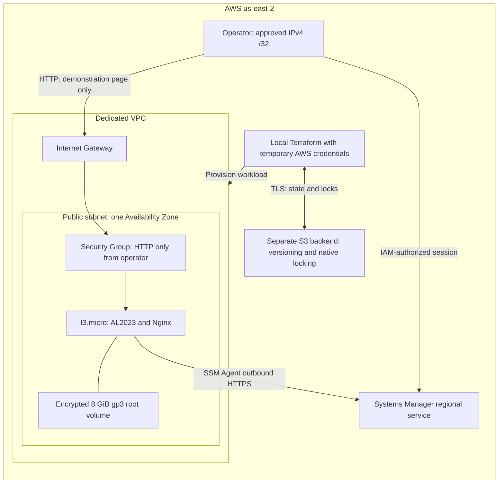

# Architecture baseline for v1

**Decision date:** 2026-11-06. **State updated:** 2026-11-09. Design selected after the [cost review](cost-review.md); bootstrap code and offline tests are complete. Workload implementation and all AWS deployment remain pending.

## Purpose and boundary

Build a temporary, reproducible infrastructure lab in us-east-2. Demonstrate the network path, administrative access, Terraform state, a controlled change, and cleanup. Serve a static Nginx demonstration page with no sign-in, application data, or secrets.

This is a single-Availability-Zone learning environment. It does not provide high availability, a production availability target, or production HTTPS hosting.

## Components and decisions

| Component | v1 decision | Reason |
| --- | --- | --- |
| Region / environment | us-east-2 / dev | Match the existing AWS project's selected Region |
| Network | Dedicated VPC, one public subnet, route table, Internet Gateway | Make routing visible with a small resource set |
| Compute | One On-Demand t3.micro, Linux x86_64 | Sufficient baseline for a small Nginx lab and broad compatibility |
| Operating system | Amazon Linux 2023, Amazon-owned, x86_64 | Use the regional public SSM AMI parameter; verify and pin its resolved image for the first implementation |
| CPU credits | Explicit standard mode | Avoid metered surplus CPU credits; bootstrapping can be slower when credits are exhausted |
| Root storage | One 8 GiB gp3 volume, 3,000 IOPS / 125 MiB/s, encrypted, delete on termination | Keep baseline provisioned storage and performance |
| Web access | TCP 80 from the operator's current public IPv4 /32 only | Demonstrate HTTP connectivity without publishing the lab to all sources |
| Administration | Session Manager; no inbound SSH or key pair | Separate IAM-controlled management from web traffic |
| Service access | Instance profile with the permissions needed by SSM | No embedded AWS credentials or human-access role changes |
| Remote state | S3 Standard, versioning, SSE-S3, public access blocked, ACLs disabled, TLS enforced | Protect state and allow recovery without a custom KMS key |
| State locking | S3 native locking with use_lockfile | Keep the backend small; no DynamoDB lock table |
| Resource lifecycle | Workload created for a session and destroyed afterward | Match the cost model and practice reproducibility |

The reviewed regional Amazon Linux image was marked available and Free Tier eligible, with an 8 GiB gp3 root mapping. Its source mapping was not encrypted: explicitly enable root-volume encryption in our configuration. Resolve the AMI from the regional public parameter during implementation rather than copying an image ID from another Region.

## Network and control paths

The instance needs an auto-assigned public IPv4 address and a default route through the Internet Gateway for its outbound SSM and package-repository connectivity. No inbound administrative port is needed. SSM establishes the management path through agent-initiated service connections; it is not a public SSH listener.

The S3 bucket is a regional service outside the VPC. Terraform accesses it from the operator's computer; the EC2 instance does not need permission to read its own Terraform state. Terraform provisions IAM and instance resources as well as the network; the diagram groups that control path for readability.

## Separate bootstrap and workload lifecycles

Two Terraform roots are prepared: bootstrap for the backend and dev for the disposable workload. Bootstrap code is implemented; dev remains a scaffold. Their state keys are separate. Initial bootstrap state stays in a protected local location outside the repository, then migrates to the remote backend once it exists. The [bootstrap runbook](bootstrap.md) documents preparation, migration, recovery, and reverse migration before final backend destruction. These procedures have not been exercised against AWS.

A normal workload teardown must preserve the backend used to track it. Do not expire current state automatically or delete all bucket versions during a practice-session cleanup. Version retention and any final deletion require a deliberate recovery and cleanup procedure.

## Cost and security tradeoffs

- A public subnet plus one metered IPv4 address provides straightforward outbound connectivity. A private-subnet design using NAT or multiple interface endpoints would need a different cost model.
- t4g.micro is a documented ARM alternative. It has a lower compute rate, but the first version keeps x86; revisit when testing ARM or container portability.
- Standard CPU-credit mode can throttle CPU after credits are depleted. Do not switch to unlimited mode to work around slow package installation without a new cost review. See [AWS's credit-mode documentation](https://docs.aws.amazon.com/AWSEC2/latest/UserGuide/burstable-performance-instances-unlimited-mode.html).
- HTTP is acceptable here only for a temporary, source-restricted static demo with no sensitive payload. A production service needs a separate TLS and availability design.
- S3 and EBS require encryption at rest; AWS management and state traffic must use TLS. Review least-privilege access and prevent public state access. See [S3 security practices](https://docs.aws.amazon.com/AmazonS3/latest/userguide/security-best-practices.html) and [EBS security](https://docs.aws.amazon.com/ebs/latest/userguide/security.html).
- Enhanced session logging, S3 access logs / CloudTrail data events, and request metrics are recommended additions for a production design, but their destinations, retention, and cost must be reviewed before enabling them. They are not included in this lab estimate. Do not claim that session command content or S3 object access is already audited.
- No NAT Gateway, load balancer, Elastic IP allocation, custom KMS key, database, domain purchase, cross-Region resource, or automated deployment is part of v1.

## Validation required before implementation is accepted

1. Recheck Free plan status, credit coverage, Region, and expiration before apply; confirm a compatible AMI and instance type remain available.
2. Pin tool/provider versions, commit the provider lock file, and keep credentials, state, and saved plans out of Git.
3. Verify HTTP from the allowed source, blocked access from other sources, no inbound SSH, and a working SSM session.
4. Check encryption, IMDSv2, public-access settings, and separate state/instance permissions.
5. Confirm a second plan has no changes; make and verify one controlled change.
6. Verify a disposable two-client state-locking test serializes writes; never force-unlock an active operation.
7. Destroy the workload when authorized, confirm no lab instance / disk / public address remains, and account for the retained backend.

Before workload implementation, choose a VPC CIDR that does not overlap any connected network and confirm the operator's source /32. During implementation, review permissions and quotas; type availability and published service support do not guarantee launch capacity.

For state locking and recovery details, use [HashiCorp's S3 backend documentation](https://developer.hashicorp.com/terraform/language/backend/s3). See the [cost review](cost-review.md) for the operating envelope. These documents are design artifacts, not evidence of a deployed system.
